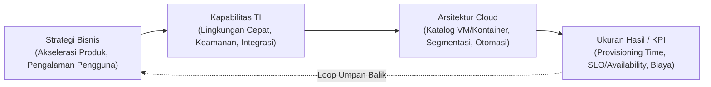

# Rangkuman Perkuliahan Business Cloud Design

**Materi Minggu 3: Private Cloud dan IT Alignment**  
**Prompt:**  
> "Tolong buatkan rangkuman komprehensif untuk materi kuliah Business Cloud Design Pertemuan 3 dengan topik 'Private Cloud dan IT Alignment'. Rangkuman harus mencakup: definisi dan konteks private cloud, perbedaan esensial antara virtualisasi biasa dengan private cloud (termasuk konsep showback vs chargeback), kriteria kelayakan implementasi private cloud, rantai alignment dari strategi bisnis ke operasi TI, sasaran bisnis (Cepat, Andal, Aman, Efisien) beserta prinsip desain pendukungnya, tata kelola dan guardrails, peran dan tanggung jawab stakeholder, indikator kinerja utama (KPI) yang komprehensif melebihi sekadar uptime, roadmap implementasi berbasis alignment (Discover, Design, Pilot, Scale), serta jebakan/risiko umum alignment seperti cloud-washing dan metrics theater."

**Bagian yang disesuaikan dari keluaran prompt ada pada:**  
1. Menegaskan perbedaan mendasar bahwa *Virtualisasi $\neq$ Private Cloud*, khususnya keberadaan lapisan layanan, otomatisasi *self-service*, dan tata kelola alokasi biaya (*showback* vs *chargeback*).  
2. Mengelaborasi rantai keselarasan (*alignment chain*) empat lapis: Strategi Bisnis $\rightarrow$ Kapabilitas $\rightarrow$ Arsitektur $\rightarrow$ Ukuran Hasil.  
3. Memperdalam analisis studi kasus universitas terkait penyediaan lingkungan praktikum dan layanan akademik digital dengan keterbatasan sumber daya.  
4. Merinci 4 risiko kegagalan alignment (*technology-first*, *ownership kabur*, *cloud-washing*, dan *metrics theater*).

---

## 1. Konsep Private Cloud dan Batasannya
**Private Cloud** adalah model lingkungan komputasi awan yang disediakan secara eksklusif untuk satu organisasi dengan kebijakan tata kelola dan kontrol internal penuh. 
* Penempatan fisik private cloud dapat berada di pusat data (*data center*) internal milik sendiri, *colocation*, maupun dikelola pihak ketiga (*hosted private cloud*).
* **Definisi Praktis:** Layanan infrastruktur yang dapat diminta, disediakan, diamankan, dan dipantau melalui mekanisme standar yang terotomatisasi.

---

## 2. Perbedaan Fundamental: Virtualisasi vs Private Cloud
Banyak institusi terjebak dalam anggapan bahwa memiliki server dengan banyak mesin virtual (*virtual machine*) sudah berarti memiliki private cloud.

| Dimensi | Virtualisasi Murni | Private Cloud |
| :--- | :--- | :--- |
| **Fokus Utama** | Abstraksi perangkat keras dan isolasi beban kerja (*workload*). | Penyediaan layanan komputasi terkelola (*service delivery*). |
| **Penyediaan (*Provisioning*)** | Dilakukan secara manual oleh administrator sistem. | Portal *self-service* terotomatisasi sesuai katalog layanan. |
| **Tata Kelola Finansial** | Tidak ada mekanisme pembebanan biaya unit pengguna. | Memiliki fitur **Showback** (pelaporan transparansi biaya) atau **Chargeback** (penagihan riil biaya komputasi ke unit bisnis pemakai). |
| **Komponen Pendukung** | Cukup hypervisor dan server fisik. | Melibatkan katalog layanan, otomasi orkestrasi, kontrol akses (RBAC), *metering*, dan pemantauan SLA. |

> **Catatan Finansial:** *Showback* menumbuhkan kesadaran (*awareness*) efisiensi tanpa memotong anggaran unit, sedangkan *Chargeback* secara nyata membebankan biaya ke anggaran departemen terkait untuk mendorong disiplin konsumsi sumber daya.

---

## 3. Kapan Organisasi Membutuhkan Private Cloud?
Private cloud layak dipertimbangkan jika memenuhi kriteria berikut:
1. **Regulasi dan Kontrol Ketat:** Kewajiban kepatuhan hukum, kedaulatan data sensitif, dan isolasi jaringan mutlak.
2. **Pola Beban Kerja Terprediksi:** Workload yang stabil sehingga kapasitas perangkat keras dapat dioptimalkan tanpa risiko *idle resource* berlebih.
3. **Penyatuan Platform Bersama (*Shared Platform*):** Adanya kebutuhan standardisasi lingkungan komputasi untuk banyak divisi, fakultas, atau unit bisnis.
4. **Kesiapan Finansial & Operasional:** Organisasi memiliki kapabilitas SDM teknis untuk merawat siklus hidup infrastruktur dan memiliki *business case* TCO yang positif.

---

## 4. Rantai IT Alignment: Dari Sasaran Bisnis Menuju Operasi
IT Alignment memastikan bahwa setiap keputusan arsitektur teknologi dapat dipertanggungjawabkan langsung terhadap pencapaian sasaran bisnis organisasi.

### Empat Pilar Sasaran Bisnis dan Keputusan Desain Cloud
1. **Cepat (*Agility*):** Otomatisasi *provisioning* dan alur persetujuan (*approval*) adaptif berbasis profil risiko.
2. **Andal (*Reliability*):** Penetapan target terukur melalui **SLO** (*Service Level Objective*), redundansi komponen, dan uji pemulihan cadangan berkala (*restore testing*).
3. **Aman (*Security*):** Penerapan prinsip hak akses terendah (*Principle of Least Privilege*), klasifikasi kerahasiaan data, segmentasi jaringan, dan *audit logging*.
4. **Efisien (*Cost Efficiency*):** Manajemen siklus hidup instans (*lifecycle VM*), perencanaan kapasitas terukur, dan *right-sizing* sumber daya.

---

## 5. Tata Kelola (*Governance*) dan Guardrails
Tata kelola cloud yang efektif tidak boleh menciptakan hambatan birokrasi, melainkan menetapkan **Guardrails**: seperangkat kebijakan, aturan, dan batasan otomatis yang memastikan pengembang dapat berinovasi dengan cepat tanpa melanggar kepatuhan keamanan atau anggaran.

### Matriks Peran dan Tanggung Jawab
* **Pimpinan Bisnis:** Menetapkan visi bisnis, target strategis, dan toleransi risiko.
* **CIO / Pimpinan TI:** Menyelaraskan portofolio teknologi dengan strategi korporasi.
* **Platform Team:** Merancang katalog layanan, mengotomatisasi *pipeline*, dan menjaga keandalan sistem.
* **Security & Finance:** Mengaudit kepatuhan, menetapkan kontrol keamanan, dan mengevaluasi efisiensi biaya operasional.

---

## 6. Indikator Kinerja Utama (KPI): Melebihi Sekadar Uptime
Mengukur keberhasilan cloud tidak cukup hanya dengan angka ketersediaan server (*uptime*). KPI harus mencakup 4 dimensi:
1. **Dimensi Kecepatan:** Waktu pemenuhan permintaan dari tiket ke instans aktif (*lead time provisioning*).
2. **Dimensi Keandalan:** Angka ketersediaan layanan (*availability*), frekuensi insiden, MTTR (*Mean Time to Repair*), serta rasio keberhasilan *restore test*.
3. **Dimensi Efisiensi:** Persentase utilisasi CPU/RAM/Storage riil, biaya per beban kerja (*cost per workload*), dan kapasitas tidak terpakai (*idle capacity*).
4. **Dimensi Kepatuhan & Pengalaman Pengguna:** Skor kepuasan pengguna internal, kepatuhan *patching*, dan temuan audit keamanan.

---

## 7. Roadmap Implementasi Berbasis Alignment
1. **Discover:** Pemetaan portofolio aplikasi, klasifikasi data, profil risiko, stakeholder, dan penetapan baseline biaya.
2. **Design:** Pemilihan beban kerja perintis (*pilot workload*), arsitektur target, guardrails keamanan, dan penentuan target SLO.
3. **Pilot:** Pengujian pada skala terbatas untuk memvalidasi performa, mekanisme *backup-restore*, dan kepuasan pengguna.
4. **Scale:** Perluasan katalog layanan mandiri, implementasi otomasi menyeluruh, integrasi *showback/chargeback*, dan perbaikan berkesinambungan.

---

## 8. Empat Risiko Utama Kegagalan Alignment
* **Technology-First:** Membeli perangkat keras atau lisensi canggih sebelum menganalisis kebutuhan proses bisnis nyata.
* **Ownership Kabur:** Tidak adanya pemilik layanan (*service owner*) yang bertanggung jawab atas performa, anggaran, dan keamanan beban kerja.
* **Cloud-Washing:** Menamai lingkungan virtualisasi lama sebagai "Private Cloud" padahal masih dikelola manual tanpa otomatisasi dan *governance*.
* **Metrics Theater:** Menyajikan metrik teknis (seperti uptime server 99.9%) yang terlihat bagus di atas kertas, tetapi layanan bisnis pengguna sebenarnya sering mengalami error.
