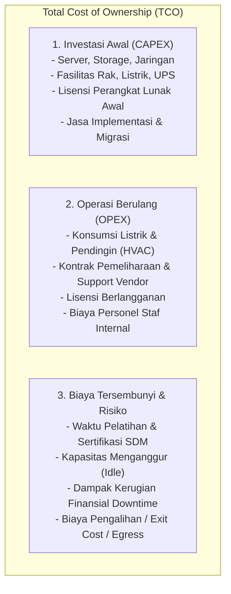

# Rangkuman Perkuliahan Business Cloud Design

**Materi Minggu 4: Ekonomi Private Cloud dan Capital Expenditure**  
**Prompt:**  
> "Tolong buatkan rangkuman komprehensif untuk materi kuliah Business Cloud Design Pertemuan 4 dengan topik 'Ekonomi Private Cloud dan Capital Expenditure'. Rangkuman harus mencakup: fondasi terminologi ekonomi cloud, perbandingan fundamental CAPEX vs OPEX beserta implikasi arus kas dan depresiasi akuntansi, faktor pendorong ekonomi private cloud, pemetaan biaya komprehensif TCO (akuisisi, operasional, biaya tersembunyi, hingga akhir masa pakai), konsep unit ekonomi (biaya per VM-bulan, per pengguna, per transaksi), manajemen utilisasi dan headroom, kerangka kerja 6 langkah keputusan investasi, analisis studi kasus kampus 5 tahun (di mana nominal private cloud vs public cloud bernilai sama Rp2,7 miliar) serta analisis sensitivitasnya, dan risiko-risiko ekonomi laten yang sering terabaikan."

**Bagian yang disesuaikan dari keluaran prompt ada pada:**  
1. Memperjelas perbedaan antara arus kas riil (*cash outflow*) dengan pembebanan depresiasi garis lurus pada laporan keuangan untuk investasi CAPEX perangkat keras.  
2. Menguraikan studi kasus perbandingan 5 tahun kampus (120 VM, 80 TB) yang menghasilkan nilai nominal identik (Rp2,7 Miliar) dan menganalisis mengapa keputusan strategis tidak boleh hanya bertumpu pada total rupiah semata.  
3. Memperdalam konsep *Unit Economics* dan *FinOps* sebagai alat ukur efisiensi operasional berbasis hasil bisnis.  
4. Merinci 5 risiko ekonomi tersembunyi: *technical debt*, kesenjangan keahlian staf (*skill & staffing*), ketahanan (*resilience*), *vendor lock-in*, dan *governance*.

---

## 1. Fondasi Terminologi Ekonomi Cloud
* **CAPEX (*Capital Expenditure*):** Pengeluaran modal yang dikeluarkan di awal untuk memperoleh, membangun, atau meningkatkan aset fisik jangka panjang yang memberi manfaat lebih dari satu periode akuntansi (misalnya server, SAN storage, switch jaringan, fasilitas data center).
* **OPEX (*Operational Expenditure*):** Biaya operasional rutin yang timbul secara berulang dari hari ke hari saat layanan komputasi dijalankan (misalnya listrik, pendingin data center, bandwidth, gaji staf operasional, lisensi perangkat lunak langganan, dan tagihan bulanan public cloud).
* **FinOps (*Financial Operations*):** Kerangka kerja kolaboratif lintas disiplin yang menyatukan tim teknik, keuangan, dan bisnis untuk mendorong transparansi dan akuntabilitas pengeluaran cloud.

---

## 2. Perbandingan Mendalam: CAPEX vs OPEX

| Dimensi Evaluasi | Private Cloud (Berbasis CAPEX) | Public Cloud (Berbasis OPEX Konsumsi) |
| :--- | :--- | :--- |
| **Pola Arus Kas** | Pengeluaran besar di muka (*upfront capital*). | Tersebar setiap bulan mengikuti konsumsi riil. |
| **Kapasitas Sumber Daya** | Harus dibeli sebelum digunakan (*upfront capacity*). | Elastis; dapat ditambah atau dikurangi seketika. |
| **Risiko Utilisasi** | Ditanggung penuh organisasi jika kapasitas *idle*. | Sebagian besar dialihkan ke pihak penyedia cloud. |
| **Tingkat Kendali** | Kontrol fisik dan kustomisasi konfigurasi penuh. | Bergantung pada katalog layanan dan batasan vendor. |
| **Tantangan Utama** | Risiko *over-provisioning*, siklus *hardware refresh*. | Risiko lonjakan tagihan tak terduga (*bill shock*), biaya transfer keluar (*data egress*). |

### Depresiasi Garis Lurus vs Arus Kas
Pengeluaran CAPEX tidak dibebankan sekaligus pada laporan laba rugi, melainkan dialokasikan melalui depresiasi.  
$$\text{Depresiasi Tahunan} = \frac{\text{Harga Perolehan Aset} - \text{Nilai Residu}}{\text{Umur Manfaat (Tahun)}}$$
*Contoh:* Investasi server & storage sebesar Rp600 juta dengan umur manfaat 5 tahun menghasilkan beban depresiasi akuntansi Rp120 juta/tahun, meskipun kas Rp600 juta telah keluar di awal.

---

## 3. Komponen Total Cost of Ownership (TCO)
TCO mencakup seluruh siklus hidup infrastruktur, bukan sekadar harga beli perangkat keras di awal:
$$\text{TCO} = \text{Biaya Akuisisi (Awal)} + \text{Biaya Operasional Berulang} + \text{Biaya Risiko \& Biaya Akhir Masa Pakai}$$

---

## 4. Dari Total Biaya Menuju Unit Economics
Untuk membandingkan alternatif secara objektif, organisasi perlu menurunkan total biaya ke dalam satuan unit ekonomi:
* **Biaya per VM-Bulan:** $\frac{\text{TCO Periode}}{\text{Total VM-Bulan yang Disediakan}}$
* **Biaya per Pengguna Aktif:** $\frac{\text{TCO Periode}}{\text{Jumlah Pengguna Aktif Terlayani}}$
* **Biaya per Transaksi:** $\frac{\text{TCO Periode}}{\text{Total Volume Transaksi Bisnis}}$

### Dilema Manajemen Utilisasi
* **Utilisasi Rendah (< 30%):** Biaya modal tetap ditanggung oleh sedikit beban kerja, menyebabkan biaya per unit melonjak drastis.
* **Utilisasi Ideal (70% – 80%):** Efisiensi biaya tercapai maksimal dengan tetap menyisakan ruang aman (*headroom*) untuk mengantisipasi lonjakan beban (*traffic spike*) dan kegagalan komponen (*failover*). Mengejar utilisasi 100% sangat berisiko merusak stabilitas dan performa sistem.

---

## 5. Kerangka 6 Langkah Keputusan Investasi Infrastruktur
1. **Analisis Kebutuhan:** Karakteristik beban kerja, target ketersediaan (SLA), kepatuhan data, dan regulasi.
2. **Perencanaan Kapasitas:** Menentukan kapasitas dasar (*baseline*), beban puncak (*peak*), laju pertumbuhan tahunan, dan batas aman (*headroom*).
3. **Pemodelan Biaya:** Mengkalkulasi TCO multitaun, pola arus kas, serta unit ekonomi.
4. **Evaluasi Risiko:** Menimbang risiko ketersediaan, kompetensi tim internal, ketergantungan penyedia (*vendor lock-in*), dan keusangan teknologi.
5. **Pemilihan Opsi:** Memilih model terbaik (*Build On-Premises, Hosted Private, Public Cloud, atau Hybrid*).
6. **Pengukuran Ulang (FinOps):** Memantau pengeluaran aktual pasca-implementasi secara berkala dan melakukan perbaikan *right-sizing*.

---

## 6. Studi Kasus: Private Cloud vs Public Cloud untuk Kampus

### Parameter Kebutuhan Institusi (Horizon Analisis 5 Tahun)
* Kebutuhan Sistem: 120 VM ekuivalen, Storage 80 TB, Target Availability 99,9%.
* **Opsi A (Private Cloud On-Premise):**
  * CAPEX Awal (Perangkat keras + Implementasi): Rp1,2 Miliar
  * OPEX Tahunan (Daya, fasilitas, maintenance): Rp300 Juta/tahun
  * $\text{TCO 5 Tahun} = \text{Rp}1.200\text{ Jt} + (5 \times \text{Rp}300\text{ Jt}) = \mathbf{Rp2.700\text{ Juta (Rp2,7 M)}}$
* **Opsi B (Public Cloud):**
  * Biaya Migrasi Awal: Rp100 Juta
  * Biaya Layanan Komputasi & Storage: Rp520 Juta/tahun
  * $\text{TCO 5 Tahun} = \text{Rp}100\text{ Jt} + (5 \times \text{Rp}520\text{ Jt}) = \mathbf{Rp2.700\text{ Juta (Rp2,7 M)}}$

### Analisis Strategis: Mengapa Angka Nominal Sama Mengharuskan Evaluasi Mendalam?
Meskipun total biaya nominal keduanya sama persis di angka **Rp2,7 Miliar**, keputusan arsitektur tidak boleh berhenti pada angka rupiah:
1. **Pola Arus Kas:** Private cloud menuntut ketersediaan dana tunai besar Rp1,2 M di hari pertama, sedangkan public cloud menyebarkan beban keuangan secara merata tiap tahun.
2. **Analisis Sensitivitas:**
   * Jika utilisasi riil kampus turun menjadi 50%, biaya private cloud tetap Rp2,7 M (aset *idle*), sementara tagihan public cloud dapat diturunkan.
   * Jika terjadi lonjakan data atau fluktuasi nilai tukar (kurs valas) dan biaya transfer keluar (*data egress*), tagihan public cloud berisiko membengkak melampaui Rp2,7 M.
3. **Kesiapan SDM Internal:** Mengoperasikan private cloud mandiri menuntut tim IT kampus yang mampu merawat perangkat keras, storage SAN, dan jaringan fisik 24/7.
