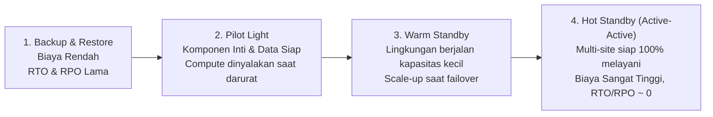

# Rangkuman Perkuliahan Business Cloud Design

**Materi Minggu 6: Desain High Availability dan Efisiensi Infrastruktur**  
**Prompt:**  
> "Tolong buatkan rangkuman komprehensif untuk materi kuliah Business Cloud Design Pertemuan 6 dengan topik 'Desain High Availability dan Efisiensi Infrastruktur'. Rangkuman harus mencakup: dilema penyeimbangan antara High Availability dan efisiensi biaya/kompleksitas, metrik matematis ketersediaan sistem (Availability, MTBF, MTTR, serta tabel konversi downtime tahunan), perbedaan esensial RTO vs RPO, identifikasi SPOF dan Failure Domain, pola redundansi dan load balancing, perbandingan arsitektur Stateful vs Stateless, ketersediaan tingkat basis data (Primary-Standby, replikasi sinkron vs asinkron, split-brain, dan mekanisme fencing), arsitektur Multi-AZ vs Multi-Region, 4 spektrum strategi Disaster Recovery (Backup & Restore, Pilot Light, Warm Standby, Hot Standby), kaidah backup 3-2-1, fondasi Observability (Metrics, Logs, Traces) serta konsep SRE Error Budget, strategi efisiensi kapasitas (Vertical vs Horizontal vs Autoscaling, storage tiering, caching/CDN), dan penyelesaian studi kasus portal akademik."

**Bagian yang disesuaikan dari keluaran prompt ada pada:**  
1. Menyertakan simulasi perhitungan matematis availability berbasis MTBF dan MTTR dari slide kuliah menggunakan Python script.  
2. Menyajikan tabel konversi persentase ketersediaan (*nines of availability*) ke dalam durasi toleransi downtime tahunan (365 hari).  
3. Memperdalam konsep mitigasi kegagalan basis data terdistribusi (*split-brain*) menggunakan mekanisme *fencing* dan *quorum*.  
4. Merinci trade-off segitiga arsitektur: *Availability vs Cost vs Complexity*.  
5. Memaparkan solusi komprehensif studi kasus Portal Layanan Akademik (KRS) untuk mencapai target RTO $\le$ 2 jam dan RPO $\le$ 15 menit.

---

## 1. Menyeimbangkan High Availability dan Efisiensi
Tantangan arsitektur cloud terbesar adalah **meningkatkan ketahanan sistem tanpa membangun kapasitas dan biaya yang berlebihan**.
* **High Availability (HA):** Kemampuan layanan untuk tetap beroperasi dan dapat diakses dengan tingkat gangguan yang dapat diterima (*acceptable disruption*). HA berfokus meminimalkan peluang kegagalan dan mempercepat pemulihan.
* **Efisiensi Infrastruktur:** Memastikan kapasitas komputasi, konsumsi daya, dan biaya sebanding dengan nilai bisnis tanpa mengorbankan SLA.

```
          Target Bisnis
              /\
             /  \
            /    \
Availability <----> Efisiensi Biaya
       \            /
        \          /
       Kompleksitas
```
> *Catatan Prinsip:* Desain infrastruktur yang baik bukanlah yang paling mahal atau paling canggih, melainkan yang paling tepat sasaran memenuhi toleransi risiko bisnis organisasi.

---

## 2. Metrik Matematis: Availability, MTBF, dan MTTR
Ketersediaan sistem diukur secara matematis melalui relasi antara waktu normal operasional dan waktu perbaikan:
$$\text{Availability} \approx \frac{\text{MTBF}}{\text{MTBF} + \text{MTTR}}$$
* **MTBF (*Mean Time Between Failures*):** Rata-rata durasi sistem beroperasi normal di antara dua kegagalan.
* **MTTR (*Mean Time To Repair / Recover*):** Rata-rata durasi waktu yang dibutuhkan tim teknis untuk memulihkan sistem yang rusak hingga beroperasi normal kembali.

### Simulasi Perhitungan (1 Tahun = 525.600 Menit):
Jika dalam 1 tahun diprediksi terjadi 4 kali insiden dengan total durasi pemulihan 120 menit:
* $\text{MTBF} = \frac{525.600}{4} = 131.400\text{ menit}$
* $\text{MTTR} = \frac{120}{4} = 30\text{ menit}$
* $\text{Availability} = \frac{131.400}{131.400 + 30} = \frac{131.400}{131.430} \approx \mathbf{99,977\% \approx 99,98\%}$

### Tabel Toleransi Downtime Tahunan (365 Hari):
| Tingkat Ketersediaan | Toleransi Downtime per Tahun |
| :---: | :---: |
| **99% ("Two Nines")** | $\pm$ 3 hari 15 jam 36 menit |
| **99,9% ("Three Nines")** | $\pm$ 8 jam 45 menit 57 detik |
| **99,99% ("Four Nines")** | $\pm$ 52 menit 34 detik |
| **99,999% ("Five Nines")** | $\pm$ 5 menit 15 detik |

---

## 3. Dua Sasaran Pemulihan: RTO vs RPO
* **RTO (*Recovery Time Objective*):** Batas waktu maksimal yang ditoleransi bisnis sejak insiden terjadi hingga layanan kembali beroperasi normal (*"Berapa lama sistem boleh mati?"*).
* **RPO (*Recovery Point Objective*):** Batas toleransi maksimal kehilangan data transaksi yang diukur dalam rentang waktu mundur dari saat insiden (*"Berapa banyak data transaksi yang boleh hilang?"*).

---

## 4. Mengeliminasi SPOF (*Single Point of Failure*)
**SPOF** adalah komponen tunggal pada rantai arsitektur yang jika mengalami kegagalan akan melumpuhkan seluruh sistem.
* **Failure Domain:** Batas area dampak kegagalan, mulai dari level *host*, *rack server*, *availability zone* (AZ), *region*, hingga *cloud provider*.
* **Pola Redundansi:** Menghilangkan ketergantungan tunggal dengan menyediakan komponen cadangan pada komputasi, jaringan, catu daya, dan basis data.
* **Load Balancing:** Mendistribusikan beban trafik masuk ke beberapa instans aktif menggunakan algoritma *Round Robin*, *Least Connections*, *Weighted*, atau *Latency-Based*.

---

## 5. Arsitektur Aplikasi: Stateless vs Stateful
* **Stateful Tier:** Sesi login pengguna atau file disimpan langsung di dalam memori/disk instans lokal VM. Jika VM gagal, sesi terputus dan data hilang. Sulit diskalakan secara horizontal.
* **Stateless Tier (Standar Modern):** Instans komputasi tidak menyimpan status lokal. Sesi disimpan di basis data memori terdistribusi (*shared in-memory cache* seperti Redis), dan file multimedia disimpan di *Object Storage* (seperti Amazon S3 atau MinIO). Memungkinkan instans ditambah, dikurangi, atau diganti seketika tanpa mengganggu pengguna.

---

## 6. Ketersediaan Basis Data (*DBMS Availability*)
1. **Primary-Standby:** Satu node utama melayani operasi tulis (*write*), node cadangan mengambil alih peran (*failover*) saat node utama tidak responsif.
2. **Replikasi Sinkron (*Synchronous*):** Transaksi baru dianggap selesai setelah ditulis ke node primer dan replika. Menjamin konsistensi data kuat (RPO mendekati 0), namun meningkatkan latensi penulisan.
3. **Replikasi Asinkron (*Asynchronous*):** Transaksi langsung dikonfirmasi di node utama tanpa menunggu replika selesai menyalin. Performa cepat, namun berisiko kehilangan transaksi terakhir jika node primer mendadak lumpuh.
4. **Split-Brain & Fencing:** 
   * *Split-Brain:* Kondisi berbahaya di mana klaster server terpecah komunikasi dan kedua node menganggap dirinya sebagai master aktif, berisiko menyebabkan korupsi data ganda.
   * *Fencing:* Prosedur otomatis untuk memutus dan mengisolasi (*stonith/fence*) node yang tidak merespons agar tidak merusak integritas penyimpanan bersama.

---

## 7. Spektrum Strategi Disaster Recovery (DR)


### Kaidah Backup 3-2-1:
* Simpan minimal **3 salinan data**.
* Simpan dalam **2 media penyimpanan berbeda**.
* Simpan minimal **1 salinan di lokasi terpisah / offsite / offline** (terisolasi dari jaringan utama untuk mencegah infeksi *ransomware*).
* *Catatan:* Backup **bukanlah** pengganti replikasi High Availability. Keberhasilan pembuatan backup tidak bernilai apa pun jika tidak pernah diuji proses pemulihannya (*restore test*).

---

## 8. Observability dan Budaya SRE
* **Metrics:** Data kuantitatif terukur numerik (*CPU utilization, memory usage, request latency, error rate*).
* **Logs:** Catatan peristiwa tekstual terstruktur berurutan waktu untuk analisis mendalam (*investigasi insiden*).
* **Traces:** Pelacakan alur satu permintaan pengguna melintasi puluhan *microservices* untuk mendeteksi *bottleneck*.
* **SLO (*Service Level Objective*):** Target terukur performa layanan yang disepakati bersama.
* **Error Budget:** Batas maksimal ketidakandalan (*downtime*) yang diizinkan dalam satu periode. Jika error budget masih tersisa, tim boleh merilis fitur baru dengan cepat; jika habis, rilis ditahan dan fokus dialihkan pada stabilitas infrastruktur.

---

## 9. Studi Kasus: Portal Layanan Akademik Kampus
* **Kendala Awal:** 1 VM aplikasi, 1 server database tunggal, backup harian manual, akses macet parah saat periode KRS, tim TI terbatas.
* **Target Bisnis:** Ketersediaan 99,9%, RTO $\le$ 2 jam, RPO $\le$ 15 menit, integritas pembayaran tidak boleh hilang.
* **Rancangan Solusi Arsitektur:**
  1. *Lapisan Web/Front:* Menerapkan Cloud DNS, Web Application Firewall (WAF), dan Load Balancer Multi-AZ.
  2. *Lapisan Aplikasi:* Memisahkan sesi ke Redis dan mengubah server aplikasi menjadi klaster *Stateless App Node (A & B)* dengan kapabilitas *Autoscaling* menghadapi lonjakan KRS.
  3. *Lapisan Database:* Mengonfigurasi arsitektur *DB Primary* dengan *Synchronous Standby Replica* di zona berbeda untuk memastikan RPO $\le$ 15 menit saat terjadi gangguan server utama.
  4. *Penyimpanan Berkas:* Mengalihkan file dokumen akademik ke *Cloud Object Storage* dengan aturan retensi data otomatis.
